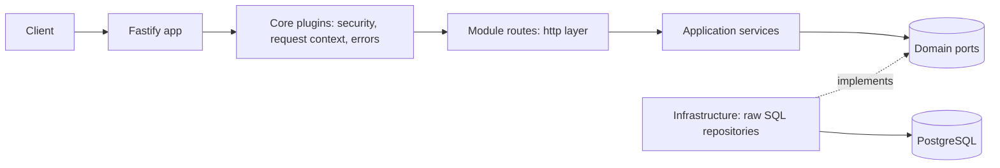

# Fastify Modular Monolith Starter

An open-source, production-minded Fastify v5 + TypeScript + PostgreSQL starter. It is a modular monolith: one deployable app made of independent modules (`auth`, `users`, `notes`) with clean layers, raw SQL, API versioning, structured logging, migrations, and tests.

## 1. Why this starter

- Fastify plugins and encapsulation instead of Express-style middleware piles
- One schema, three benefits: TypeBox gives validation, TypeScript types, and OpenAPI docs
- Raw SQL with `pg`: no ORM magic, full control, easy to reason about
- Modular monolith: clear boundaries now, easy to split into services later
- Explicit module boundaries and repository adapters make features easier to test and evolve

## 2. Tech stack

| Area       | Choice                          | Why                                              |
| ---------- | ------------------------------- | ------------------------------------------------ |
| Runtime    | Node.js (latest LTS), ESM       | Stable and long-supported                        |
| Language   | TypeScript (strict)             | Safety and refactorability                       |
| Framework  | Fastify v5                      | Fast, plugin architecture, great schema support  |
| Validation | TypeBox + Ajv                   | Schema is also the TS type and the OpenAPI spec  |
| Database   | PostgreSQL + `pg`               | Raw SQL, mature driver                           |
| Migrations | `node-pg-migrate`               | Versioned TypeScript migrations with up and down |
| Auth       | `@fastify/jwt`, argon2          | Password hashing and token-based authentication  |
| Logging    | pino (built into Fastify)       | Fast JSON logs with redaction                    |
| Docs       | `@fastify/swagger` + Swagger UI | Generated from route schemas                     |
| Tests      | Vitest, `fastify.inject`        | In-process HTTP tests with injectable adapters   |
| Quality    | ESLint, Prettier                | Consistent formatting and static checks          |

## 3. Architecture



## 4. Quick start

### Project structure

```text
src/
  app.ts                         # Fastify composition and repository selection
  main.ts                        # Process entrypoint and listener startup
  config/
    env.schema.ts                # Environment validation and defaults
    index.ts                     # Parsed and redacted application config
  core/
    plugins/
      auth.ts                    # JWT registration and authentication decorator
      error-handler.ts           # Problem response and not-found handling
      health.ts                  # Liveness and readiness routes
      request-context.ts         # Request-scoped context
      security.ts                # CORS, Helmet, and rate limiting
      swagger.ts                 # OpenAPI and Swagger UI
    types/fastify.d.ts           # Fastify instance/request type augmentation
  modules/
    auth/
      application/auth.service.ts # Register, login, refresh, and user lookup
      http/
        auth.routes.ts            # Auth endpoints
        auth.schemas.ts           # TypeBox request/response schemas
      index.ts                    # Auth module composition
    users/
      domain/
        user.ts                   # User record model
        users.repository.ts       # User persistence port
      infrastructure/
        users.repository.ts       # In-memory adapter
        postgres-users.repository.ts # PostgreSQL adapter
      index.ts                    # Users module composition
    notes/
      application/notes.service.ts # Note use cases
      domain/
        note.ts                   # Note model
        notes.repository.ts       # Notes persistence port
      http/
        notes.routes.ts           # Notes endpoints
        notes.schemas.ts          # TypeBox request/response schemas
      infrastructure/
        notes.repository.ts       # In-memory adapter
        postgres-notes.repository.ts # PostgreSQL adapter
      index.ts                    # Notes module composition
  versions/
    v1.ts                         # Versioned module composition
migrations/
  202610290001_create_users.ts   # Users schema
  202610290002_create_notes.ts   # Notes schema and user relationship
scripts/migrate.ts               # Migration up/down/create commands
tests/
  integration/auth-notes.test.ts # HTTP flow tests using Fastify inject
```

Modules contain the layers needed for their responsibilities; they are not padded
with empty folders. Auth owns authentication workflows and routes, users owns the
user model and persistence contract, and notes has the complete use-case, domain,
HTTP, and persistence layers. Application services depend on repository interfaces;
infrastructure adapters implement those interfaces. `src/app.ts` composes shared
infrastructure, and `src/versions/v1.ts` composes versioned feature modules.

### Local setup

Prerequisites: Node.js (see `.nvmrc`), Docker Compose, npm.

```bash
cp .env.example .env
npm install
docker compose up -d db
npm run migrate:up
npm run dev
```

Swagger UI: http://localhost:3000/docs

The API uses PostgreSQL by default. `npm run migrate:down` rolls back the latest
migration, and `npm run migrate:create -- add_a_table` creates a TypeScript
migration template. `/readyz` checks database connectivity; `/healthz` reports
that the process is running without requiring dependencies to be available.

## 5. API examples

```bash
# register
curl -s -X POST localhost:3000/api/v1/auth/register \
  -H 'Content-Type: application/json' \
  -d '{"email":"me@example.com","password":"a-very-long-password"}'

# login
TOKEN=$(curl -s -X POST localhost:3000/api/v1/auth/login \
  -H 'Content-Type: application/json' \
  -d '{"email":"me@example.com","password":"a-very-long-password"}' | jq -r .accessToken)

# create, list, get a note
curl -s -X POST localhost:3000/api/v1/notes \
  -H "Authorization: Bearer $TOKEN" -H 'Content-Type: application/json' \
  -d '{"title":"Hello","content":"First note"}'
curl -s localhost:3000/api/v1/notes -H "Authorization: Bearer $TOKEN"

# health
curl -s localhost:3000/healthz
curl -s localhost:3000/readyz
```

---

This repository contains a working starter implementation with Fastify v5,
TypeScript, PostgreSQL-backed modules, versioned migrations, JWT auth, notes
CRUD, and tests. The HTTP tests inject in-memory repository adapters; production
startup uses the PostgreSQL adapters and the configured `DATABASE_URL`.
