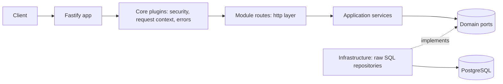

# Fastify Modular Monolith Starter

An open-source, production-minded Fastify v5 + TypeScript + PostgreSQL starter. It is a modular monolith: one deployable app made of independent modules (`auth`, `users`, `notes`) with clean layers, raw SQL, API versioning, structured logging, tests, Docker, and CI.

> This README describes the project produced by PROMPT_FASTIFY.md. If your generated code differs slightly, update the folder map in Section 4.

## 1. Why this starter

- Fastify plugins and encapsulation instead of Express-style middleware piles
- One schema, three benefits: TypeBox gives validation, TypeScript types, and OpenAPI docs
- Raw SQL with `pg`: no ORM magic, full control, easy to reason about
- Modular monolith: clear boundaries now, easy to split into services later
- Open-source ready: license, contributing guide, code of conduct, issue templates, CI, releases

## 2. Tech stack

| Area | Choice | Why |
| --- | --- | --- |
| Runtime | Node.js (latest LTS), ESM | Stable and long-supported |
| Language | TypeScript (strict) | Safety and refactorability |
| Framework | Fastify v5 | Fast, plugin architecture, great schema support |
| Validation | TypeBox + Ajv | Schema is also the TS type and the OpenAPI spec |
| Database | PostgreSQL + `pg` | Raw SQL, mature driver |
| Migrations | `node-pg-migrate` | Plain SQL files with up and down |
| Auth | `@fastify/jwt`, argon2id, rotating refresh tokens | Secure defaults |
| Logging | pino (built into Fastify) | Fast JSON logs with redaction |
| Docs | `@fastify/swagger` + Swagger UI | Generated from route schemas |
| Tests | Vitest, `fastify.inject`, Testcontainers | Fast, real database for integration |
| Quality | ESLint, Prettier, Husky, commitlint | Consistent contributions |
| Releases | Changesets | Changelog and semver |

## 3. Architecture



## 4. Quick start

Prerequisites: Node.js (see `.nvmrc`), Docker, npm.

```bash
git clone <your-repo-url> my-api && cd my-api
cp .env.example .env
npm install
npm run dev
```

Swagger UI: http://localhost:3000/docs

## 5. API examples

```bash
# register
curl -s -X POST localhost:3000/api/v1/auth/register \
  -H 'Content-Type: application/json' \
  -d '{"email":"me@example.com","password":"a-very-long-password"}'

# login
TOKEN=$(curl -s -X POST localhost:3000/api/v1/auth/login \
  -H 'Content-Type: application/json' \
  -d '{"email":"me@example.com","password":"a-very-long-password"}' | jq -r .accessToken)

# create, list, get a note
curl -s -X POST localhost:3000/api/v1/notes \
  -H "Authorization: Bearer $TOKEN" -H 'Content-Type: application/json' \
  -d '{"title":"Hello","content":"First note"}'
curl -s localhost:3000/api/v1/notes -H "Authorization: Bearer $TOKEN"

# health
curl -s localhost:3000/healthz
curl -s localhost:3000/readyz
```

---

This repository contains a working starter implementation with Fastify v5, TypeScript, modular feature routes, JWT auth, notes CRUD, and tests.
